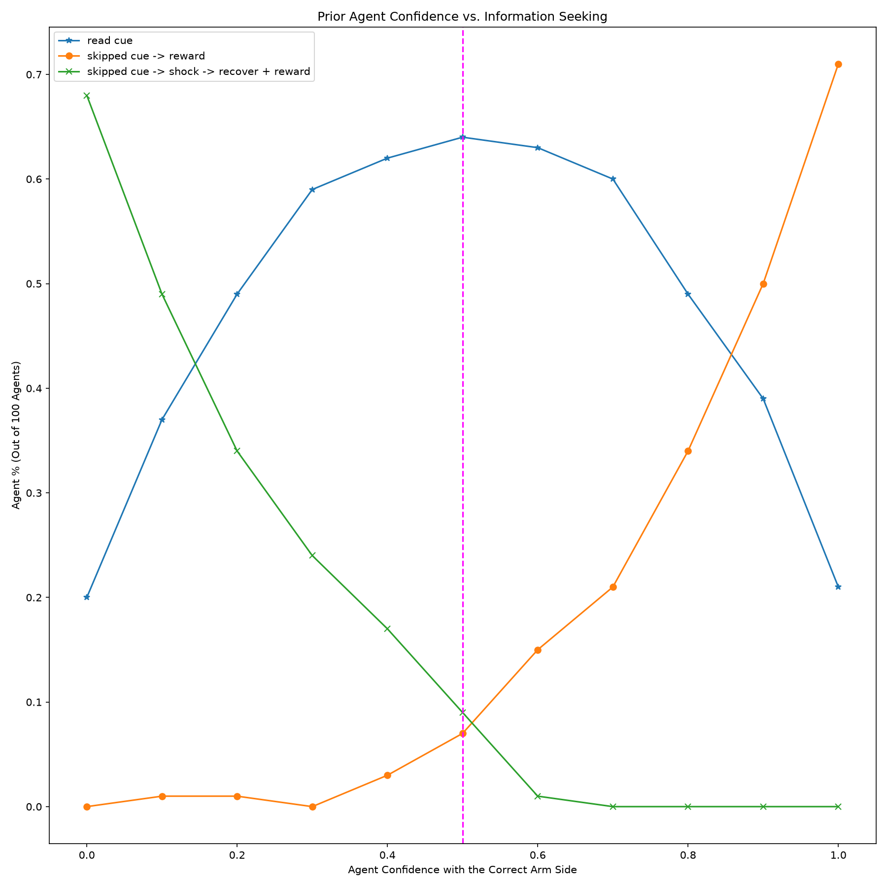

# Derived Findings: 

I tested a TMaze model on a batch size of 100 agents to gage how information-seeking behavior relates to confidence levels. 
Out of 100 agents, 65% of agents at a confidence of 0.5 sought out the cue _prior_ to reaching the reward side of the T-maze. 
As confidence grew in either direction, information-seeking behavior dwindled and instead action was preferred. 

Confidently correct agents skipped reading the cue, instead opting to rely on confidence of the correct arm side to get to the reward state. 
Approximately 71% of the confidently correct (`confidence >0.5`) sought out action instead of information-seeking and _still_ reached the reward side. 
Similarly, as illustrated on the other side of the graph, 68% of agents with _low confidence scores_ (`confidence < 0.5`) exhibited the same pragmatic behavior, but encountered an unlikely outcome first before course-correcting. 
The agents that reached shock prior to the reward state did so only through the evidence of the shock, and not from the observational cue. 
Pragmatic behavior is costly only when priors, such as confidence, is wrong; otherwise, it is beneficial in reaching the reward side quicker. 

